<p align="center">
  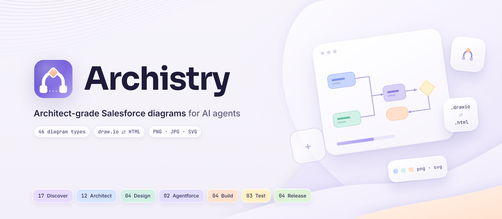
</p>

<p align="center">
  
  
  
  
  
  
  <a href="LICENSE"></a>
</p>

<p align="center">
  <a href="https://abhishakec.github.io/archistry-site/"><strong>Website</strong></a> &nbsp;·&nbsp;
  <a href="#-quick-start"><strong>Quick start</strong></a> &nbsp;·&nbsp;
  <a href="#-diagram-types"><strong>Diagram types</strong></a> &nbsp;·&nbsp;
  <a href="https://abhishakec.github.io/archistry-site/examples/agent-interaction-map.html"><strong>Live example</strong></a> &nbsp;·&nbsp;
  <a href="#-commands"><strong>Commands</strong></a> &nbsp;·&nbsp;
  <a href="SKILL.md"><strong>Skill instructions</strong></a> &nbsp;·&nbsp;
  <a href="#-credits"><strong>Credits</strong></a>
</p>

<p align="center">
  <a href="https://github.com/abhishakec/archistry/stargazers"></a>
</p>

---

<h3 align="center">Salesforce diagrams, crafted from a sentence.</h3>
<p align="center"><b><i>Architecture + artistry:</i></b> the rigour of an architect, the finish of a designer.</p>

**Archistry** is an AI-agent skill that draws the diagrams a Salesforce project needs, from the first discovery workshop to the go-live
weekend. Ask your agent in plain language; you get a **draw.io file** and an **interactive HTML
page** you can both keep editing, plus **PNG, JPG or SVG** images for your documents.


> **Built and optimised for Salesforce work**, for architects, business analysts and consultants:
> the diagram types, notation, icons and examples are all Salesforce. The engine itself is
> platform-neutral, so it can easily be used or adapted for other platforms. It does not produce
> Mermaid.

## ✨ Why Archistry

<table>
<tr>
<td width="33%" valign="top">

**🧭 The model describes, the engine draws**<br>
The agent writes *what* is in the diagram. A layout engine decides *where*, and a router takes every
connector around the boxes. No overlaps, no lines through boxes.

</td>
<td width="33%" valign="top">

**🏛️ Real Salesforce notation**<br>
Salesforce ERD notation (crow's foot, master-detail), Diagramming Framework cards and zones,
BPMN swimlanes, and the Agent Interaction Map approach for Agentforce.

</td>
<td width="33%" valign="top">

**✏️ Editable everywhere**<br>
Open the `.drawio` in draw.io or VS Code, or edit the `.html` right in the browser. Convert either
way without losing anything.

</td>
</tr>
<tr>
<td valign="top">

**🧱 About 200 Salesforce icons**<br>
Cloud, product, platform, industry and SLDS icons are embedded in the file. Nothing to install,
nothing breaks on another machine.

</td>
<td valign="top">

**✅ Checked before you see it**<br>
Every build is linted for overlaps, clipped labels, low contrast and crossings. A failed check
fails the build.

</td>
<td valign="top">

**🔒 Everything stays local**<br>
No diagramming service, no upload, no account. Specs, diagrams and images stay on your disk.

</td>
</tr>
</table>

## 🚀 Quick start

### 1. Install

```bash
npx skills add abhishakec/archistry
```

This finds the agents on your machine (Claude Code, GitHub Copilot, Cursor, Gemini CLI, Codex and more)
and installs the skill for the ones you pick. It installs into the current project; add `-g` to
install it for every project.

Prefer no extra tool? Clone it instead:

```bash
git clone https://github.com/abhishakec/archistry.git ~/.claude/skills/archistry
```

Then check your setup:

```bash
node ~/.claude/skills/archistry/scripts/archistry.mjs doctor
```

You only need **Node.js 18+**; there is nothing to `npm install`. PNG and JPG export also use a
local Chrome, Edge or Chromium.

### Update to a new release

| Installed with | Update with |
|---|---|
| `npx skills add` | `npx skills update` (add `-g` for a global install) |
| `git clone` | `git -C ~/.claude/skills/archistry pull` |

See what changed on the [Releases](https://github.com/abhishakec/archistry/releases) page.

<details>
<summary><b>Using another agent?</b> Install notes for Claude desktop, Copilot, Cursor, Gemini CLI and Codex</summary>
<br>

| Agent | How |
|---|---|
| **Claude Code** | Put the folder in `~/.claude/skills/` (all projects) or `<project>/.claude/skills/` (one project). It triggers on diagram requests |
| **Claude desktop / Cowork** | Add the folder as a skill; it triggers the same way |
| **GitHub Copilot** | Add to `.github/copilot-instructions.md`: *"For any Salesforce diagram request, follow `archistry/SKILL.md`."* |
| **Cursor** | Add a rule pointing at `archistry/SKILL.md` |
| **Gemini CLI, Codex, others** | Point the agent at `SKILL.md`. Any agent that can read files and run `node` can use it |

Optional: to edit `.drawio` files inside VS Code, install the
[draw.io Integration](https://marketplace.visualstudio.com/items?itemName=hediet.vscode-drawio)
extension. The HTML output needs nothing.

</details>

### 2. Ask your agent

| You say | You get |
|---|---|
| *"Draw the solution architecture for order management: Commerce Cloud, Sales Cloud, MuleSoft to SAP, Data Cloud and an Agentforce agent. Give me a PNG too."* | `solution-architecture` + image |
| *"Generate an ERD from `./force-app` for `Promotion__c`, `Merchant__c` and everything they relate to."* | `data-model` from real metadata |
| *"Design an Agent Interaction Map for our service agent, and an instruction diagram for the Order Status topic."* | `agent-interaction-map` + `agent-instruction-diagram` |
| *"Turn `Order_Approval.flow-meta.xml` into a flow diagram."* | `flow-logic` from the Flow XML |

### 3. Open the result

You get `diagrams/<name>.drawio` and `diagrams/<name>.html`, plus any images you asked for.

- **Open the HTML** in any browser to explore it. Press <kbd>E</kbd> to edit.
- **Open the .drawio** in draw.io desktop, [app.diagrams.net](https://app.diagrams.net/) or VS Code.


> No agent? Run it by hand: `archistry init solution-architecture -o arch.json`, edit the JSON,
> then `archistry build arch.json --format drawio,html,png`. See [Commands](#-commands).

## 📚 Diagram types

**40 types**, grouped by the project stage where you need them:

| Stage | Count | Use it for |
|---|:---:|---|
| 🔎 [Discover](#discover) | 11 | Stakeholders, RACI, capability maps, swimlane processes, journeys, story maps, fit-gap |
| 🏛️ [Architect](#architect) | 12 | Landscape, solution and integration architecture, sequences, OAuth, ERD, Data Cloud, sharing, permissions |
| 🎨 [Design](#design) | 4 | Record lifecycles, decision flows, Lightning page wireframes, Apex class diagrams |
| 🤖 [Agentforce](#agentforce) | 2 | Agent Interaction Map and Agent Instruction Diagram |
| 🛠️ [Build](#build) | 4 | Environment strategy, CI/CD pipeline, branching, Flow logic |
| 🧪 [Test](#test) | 3 | Test strategy, traceability matrix, defect lifecycle |
| 🚢 [Release](#release) | 4 | Roadmap, gantt plan, cutover plan, risk matrix |

Every picture below is the unedited output of its example spec. **Click a picture** to open the
interactive HTML version. The **Ask** line is the kind of sentence that produces it.

<!-- gallery:start -->

### Discover

Requirements, people and scope: the diagrams a BA or consultant draws in workshops.

<table>
<tr>
<td width="50%" valign="top">
<a href="examples/stakeholder-map.html">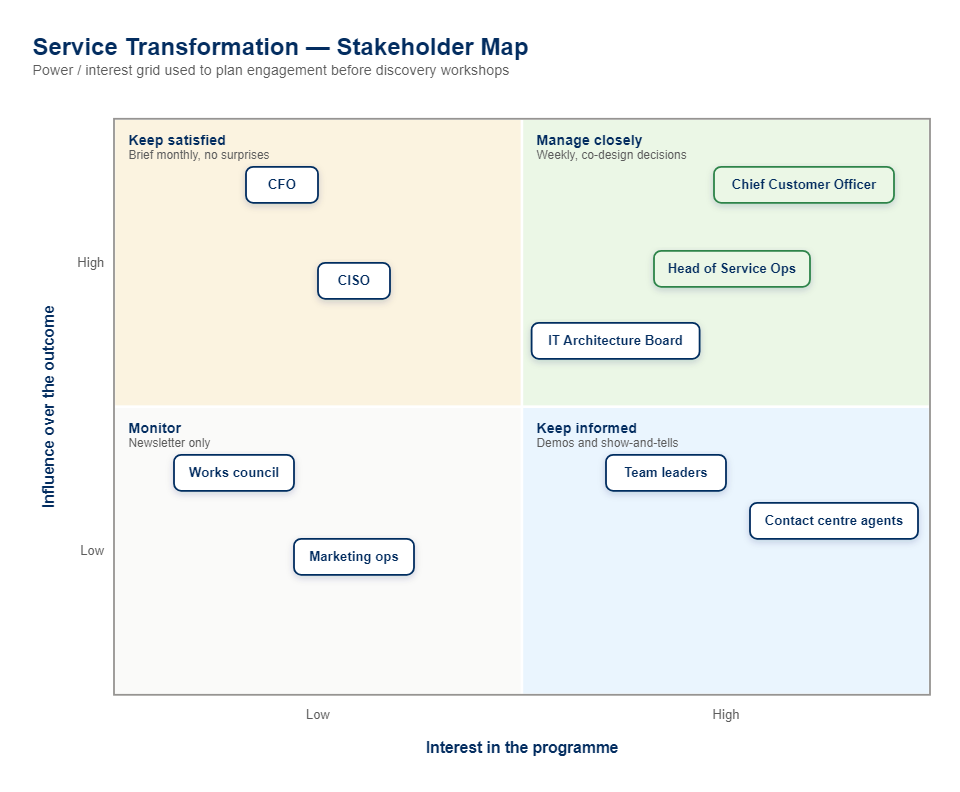</a>
<br><b><code>stakeholder-map</code></b><br>
Who has influence and interest, and how do we engage each group?<br>
<sub><b>Ask:</b> "Map our stakeholders on a power / interest grid for the Service Cloud programme."</sub><br>
<sub><a href="examples/stakeholder-map.json">spec</a> · <a href="examples/stakeholder-map.drawio">draw.io</a> · <a href="examples/stakeholder-map.html">HTML</a></sub>
</td>
<td width="50%" valign="top">
<a href="examples/org-chart.html">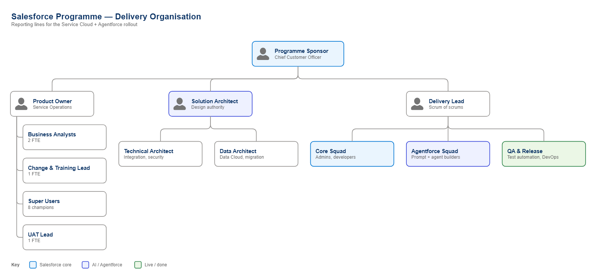</a>
<br><b><code>org-chart</code></b><br>
Who reports to whom in the business or the delivery team?<br>
<sub><b>Ask:</b> "Draw the delivery team org chart: sponsor, product owner, architect, squads."</sub><br>
<sub><a href="examples/org-chart.json">spec</a> · <a href="examples/org-chart.drawio">draw.io</a> · <a href="examples/org-chart.html">HTML</a></sub>
</td>
</tr>
<tr>
<td width="50%" valign="top">
<a href="examples/raci.html">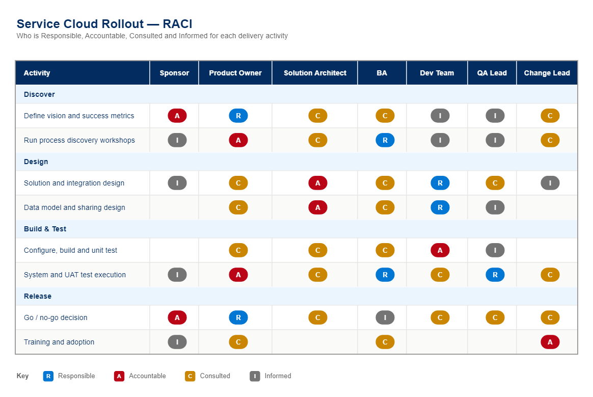</a>
<br><b><code>raci</code></b><br>
Who is Responsible, Accountable, Consulted and Informed for each activity?<br>
<sub><b>Ask:</b> "Create a RACI for discovery, design, build, test and release across the project roles."</sub><br>
<sub><a href="examples/raci.json">spec</a> · <a href="examples/raci.drawio">draw.io</a> · <a href="examples/raci.html">HTML</a></sub>
</td>
<td width="50%" valign="top">
<a href="examples/capability-map.html">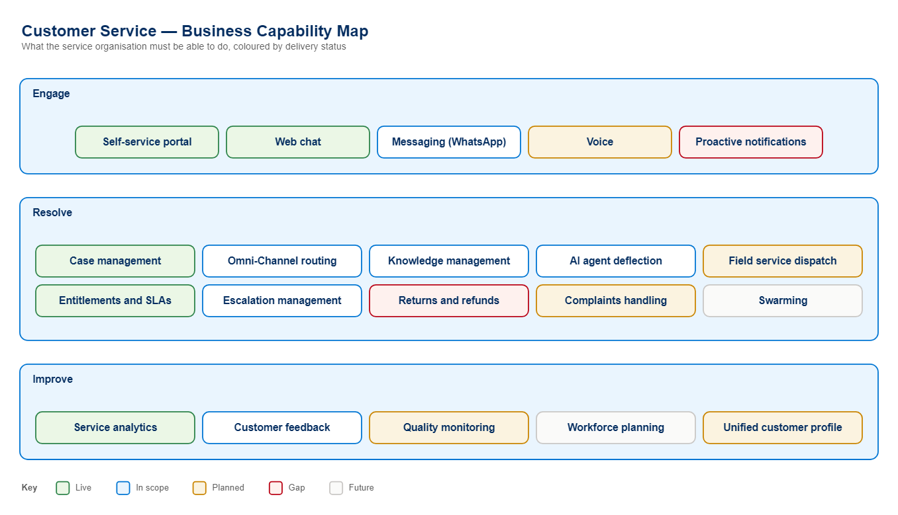</a>
<br><b><code>capability-map</code></b><br>
Which business capabilities exist and which are in scope, live or a gap?<br>
<sub><b>Ask:</b> "Build a capability map for customer service and colour it by live, in scope and gap."</sub><br>
<sub><a href="examples/capability-map.json">spec</a> · <a href="examples/capability-map.drawio">draw.io</a> · <a href="examples/capability-map.html">HTML</a></sub>
</td>
</tr>
<tr>
<td width="50%" valign="top">
<a href="examples/business-process.html">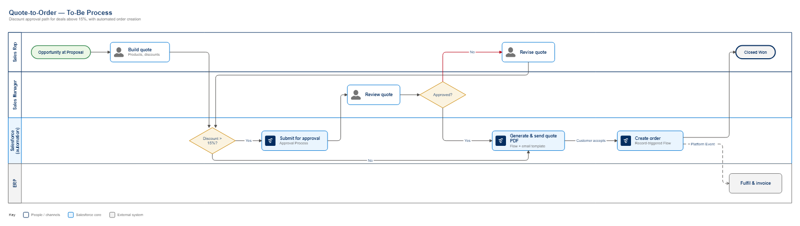</a>
<br><b><code>business-process</code></b><br>
What are the steps, who performs them and where are the decisions? (as-is / to-be, BPMN-style swimlanes)<br>
<sub><b>Ask:</b> "Diagram the to-be quote-to-order process as swimlanes with the discount approval path."</sub><br>
<sub><a href="examples/business-process.json">spec</a> · <a href="examples/business-process.drawio">draw.io</a> · <a href="examples/business-process.html">HTML</a></sub>
</td>
<td width="50%" valign="top">
<a href="examples/customer-journey.html">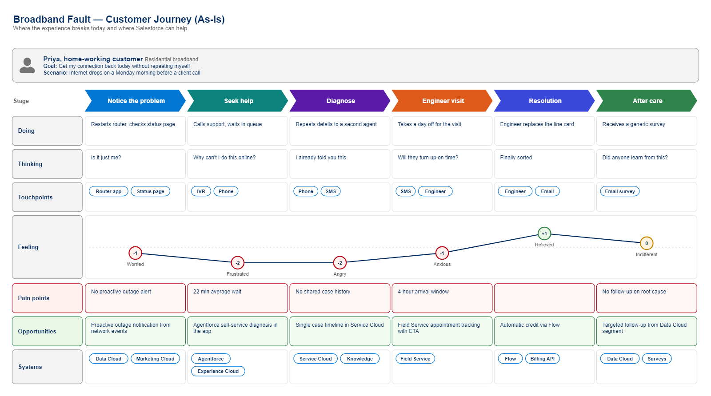</a>
<br><b><code>customer-journey</code></b><br>
What does a persona do, think and feel at each stage, and where are the pain points?<br>
<sub><b>Ask:</b> "Create an as-is customer journey map for a broadband fault, with pain points and opportunities."</sub><br>
<sub><a href="examples/customer-journey.json">spec</a> · <a href="examples/customer-journey.drawio">draw.io</a> · <a href="examples/customer-journey.html">HTML</a></sub>
</td>
</tr>
<tr>
<td width="50%" valign="top">
<a href="examples/service-blueprint.html">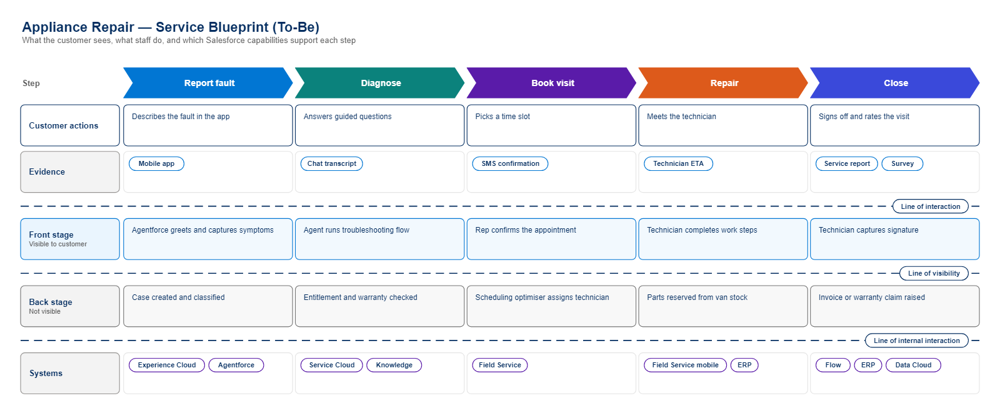</a>
<br><b><code>service-blueprint</code></b><br>
How do front-stage, back-stage and systems line up behind each customer step?<br>
<sub><b>Ask:</b> "Draw a service blueprint for appliance repair with front stage, back stage and systems."</sub><br>
<sub><a href="examples/service-blueprint.json">spec</a> · <a href="examples/service-blueprint.drawio">draw.io</a> · <a href="examples/service-blueprint.html">HTML</a></sub>
</td>
<td width="50%" valign="top">
<a href="examples/user-story-map.html">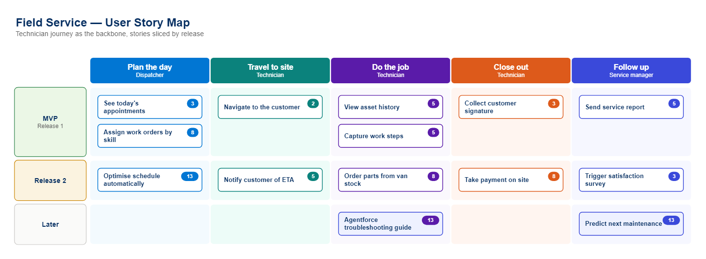</a>
<br><b><code>user-story-map</code></b><br>
Which stories sit under each activity and in which release slice?<br>
<sub><b>Ask:</b> "Lay out a user story map for field technicians, sliced into MVP and Release 2."</sub><br>
<sub><a href="examples/user-story-map.json">spec</a> · <a href="examples/user-story-map.drawio">draw.io</a> · <a href="examples/user-story-map.html">HTML</a></sub>
</td>
</tr>
<tr>
<td width="50%" valign="top">
<a href="examples/system-context.html">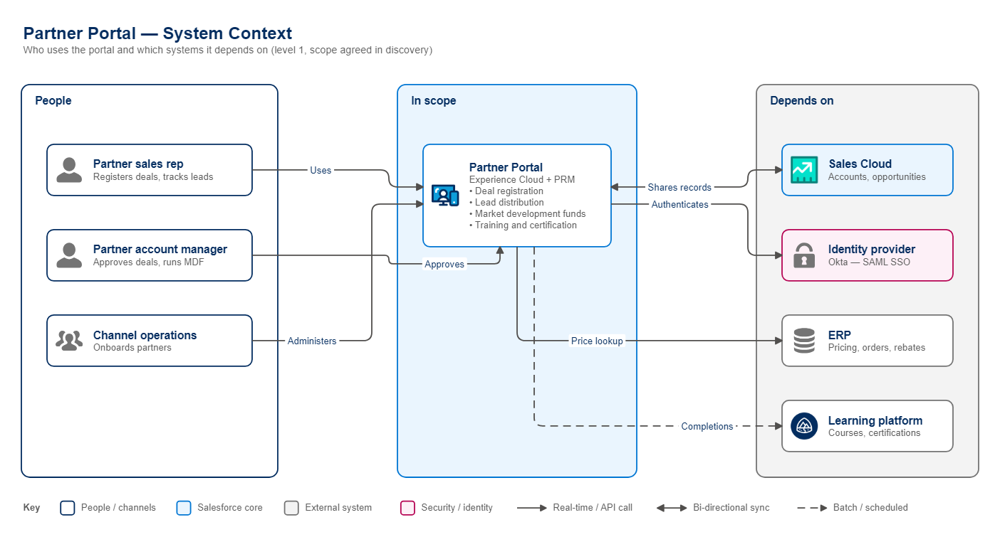</a>
<br><b><code>system-context</code></b><br>
Which people and systems surround the solution and what flows between them?<br>
<sub><b>Ask:</b> "Draw a system context diagram for the partner portal: users on the left, dependencies on the right."</sub><br>
<sub><a href="examples/system-context.json">spec</a> · <a href="examples/system-context.drawio">draw.io</a> · <a href="examples/system-context.html">HTML</a></sub>
</td>
<td width="50%" valign="top">
<a href="examples/fit-gap-analysis.html">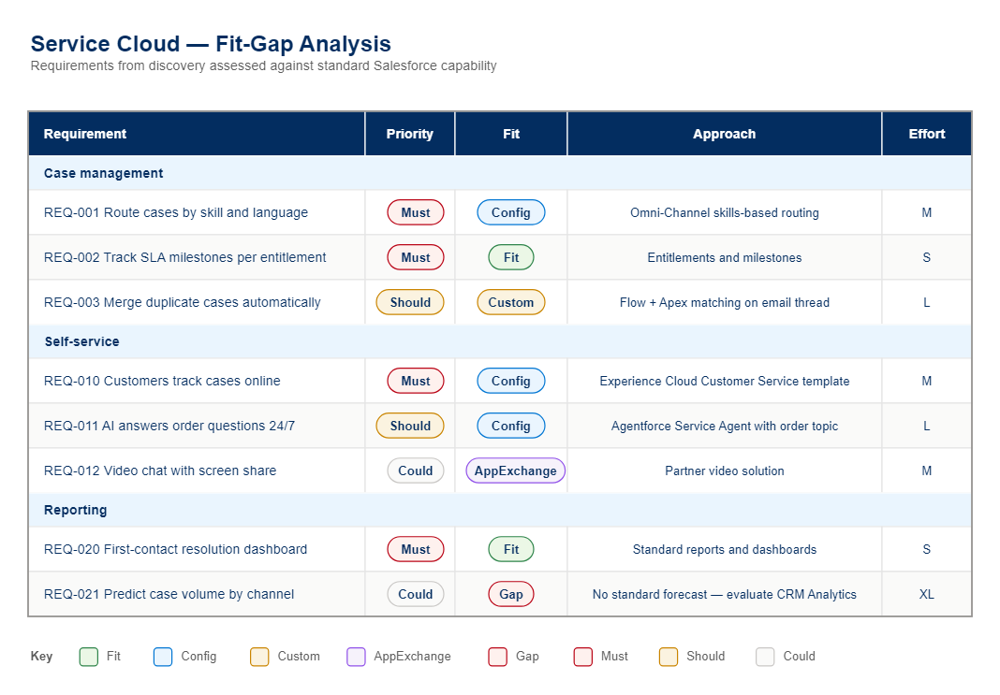</a>
<br><b><code>fit-gap-analysis</code></b><br>
Which requirements are met out of the box, by configuration, by custom build, or not at all?<br>
<sub><b>Ask:</b> "Turn these requirements into a fit-gap analysis: standard, config, custom or gap."</sub><br>
<sub><a href="examples/fit-gap-analysis.json">spec</a> · <a href="examples/fit-gap-analysis.drawio">draw.io</a> · <a href="examples/fit-gap-analysis.html">HTML</a></sub>
</td>
</tr>
<tr>
<td width="50%" valign="top">
<a href="examples/prioritization-matrix.html">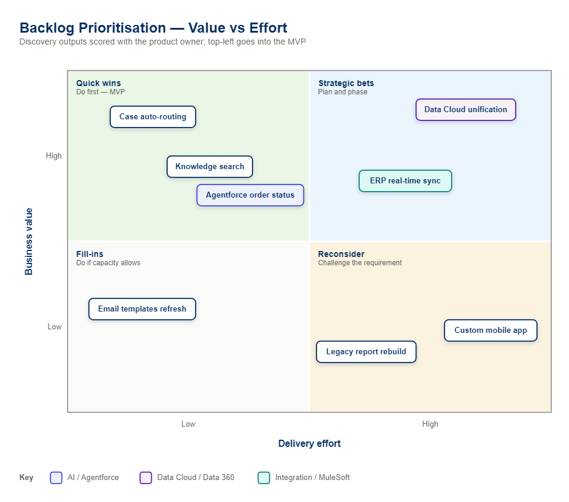</a>
<br><b><code>prioritization-matrix</code></b><br>
Which backlog items give the most value for the least effort?<br>
<sub><b>Ask:</b> "Plot the backlog on a value vs effort matrix."</sub><br>
<sub><a href="examples/prioritization-matrix.json">spec</a> · <a href="examples/prioritization-matrix.drawio">draw.io</a> · <a href="examples/prioritization-matrix.html">HTML</a></sub>
</td>
<td width="50%"></td>
</tr>
</table>

### Architect

Landscape, integration, data and security: the architect's core set.

<table>
<tr>
<td width="50%" valign="top">
<a href="examples/system-landscape.html">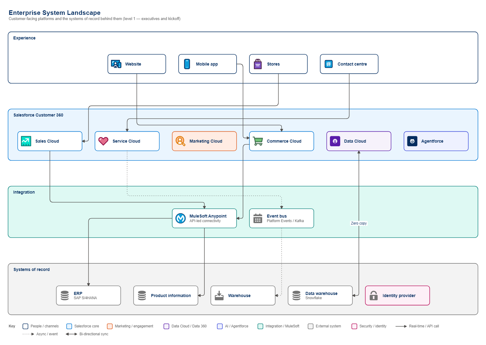</a>
<br><b><code>system-landscape</code></b><br>
Which systems exist across the enterprise and how are they grouped and connected?<br>
<sub><b>Ask:</b> "Draw our enterprise system landscape with Salesforce clouds, MuleSoft and systems of record."</sub><br>
<sub><a href="examples/system-landscape.json">spec</a> · <a href="examples/system-landscape.drawio">draw.io</a> · <a href="examples/system-landscape.html">HTML</a></sub>
</td>
<td width="50%" valign="top">
<a href="examples/solution-architecture.html">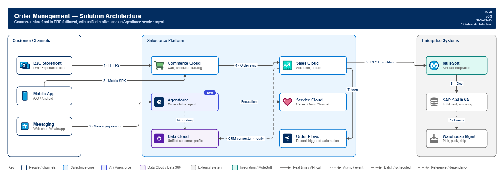</a>
<br><b><code>solution-architecture</code></b><br>
Which products and components make up this solution and how do they interact?<br>
<sub><b>Ask:</b> "Draw the solution architecture for order management: Commerce, Sales Cloud, MuleSoft to SAP, Data Cloud and an Agentforce agent."</sub><br>
<sub><a href="examples/solution-architecture.json">spec</a> · <a href="examples/solution-architecture.drawio">draw.io</a> · <a href="examples/solution-architecture.html">HTML</a></sub>
</td>
</tr>
<tr>
<td width="50%" valign="top">
<a href="examples/integration-architecture.html">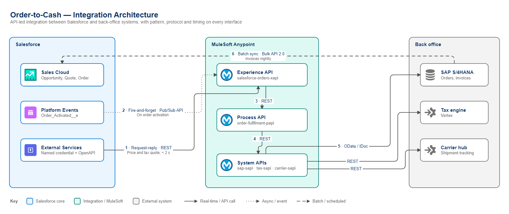</a>
<br><b><code>integration-architecture</code></b><br>
Which integrations exist, with what pattern, protocol, direction and frequency?<br>
<sub><b>Ask:</b> "Show the order-to-cash integration architecture with pattern, protocol and timing on each interface."</sub><br>
<sub><a href="examples/integration-architecture.json">spec</a> · <a href="examples/integration-architecture.drawio">draw.io</a> · <a href="examples/integration-architecture.html">HTML</a></sub>
</td>
<td width="50%" valign="top">
<a href="examples/sequence.html">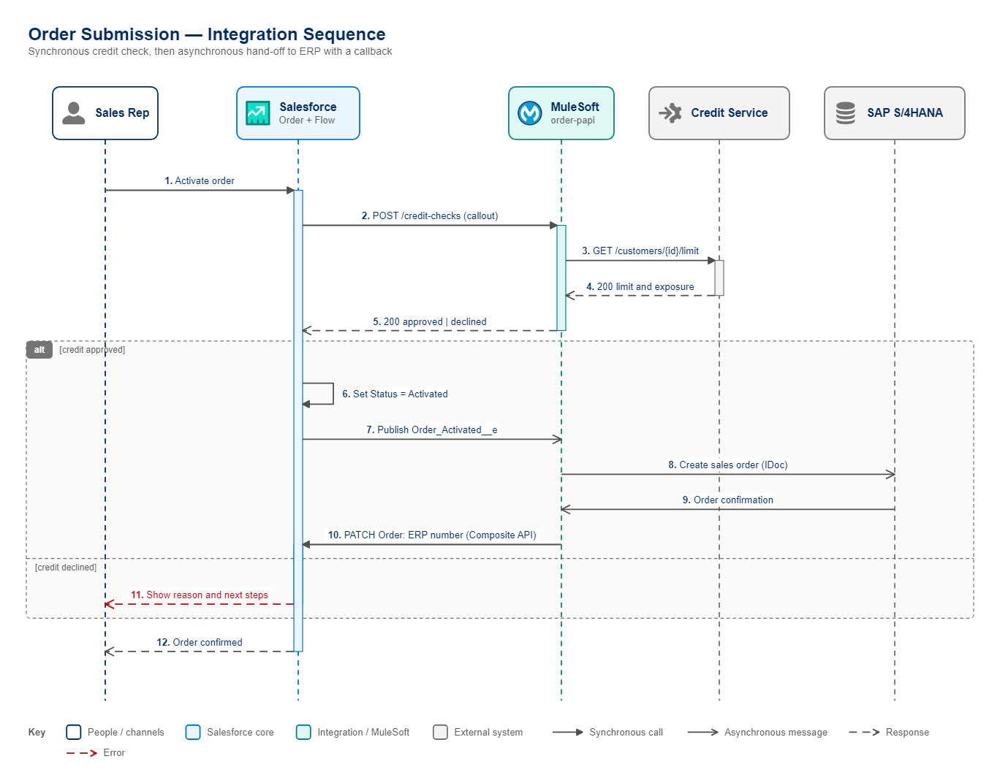</a>
<br><b><code>sequence</code></b><br>
In what order do systems and people message each other?<br>
<sub><b>Ask:</b> "Create a sequence diagram for order submission with a synchronous credit check and an async ERP hand-off."</sub><br>
<sub><a href="examples/sequence.json">spec</a> · <a href="examples/sequence.drawio">draw.io</a> · <a href="examples/sequence.html">HTML</a></sub>
</td>
</tr>
<tr>
<td width="50%" valign="top">
<a href="examples/oauth-flow.html">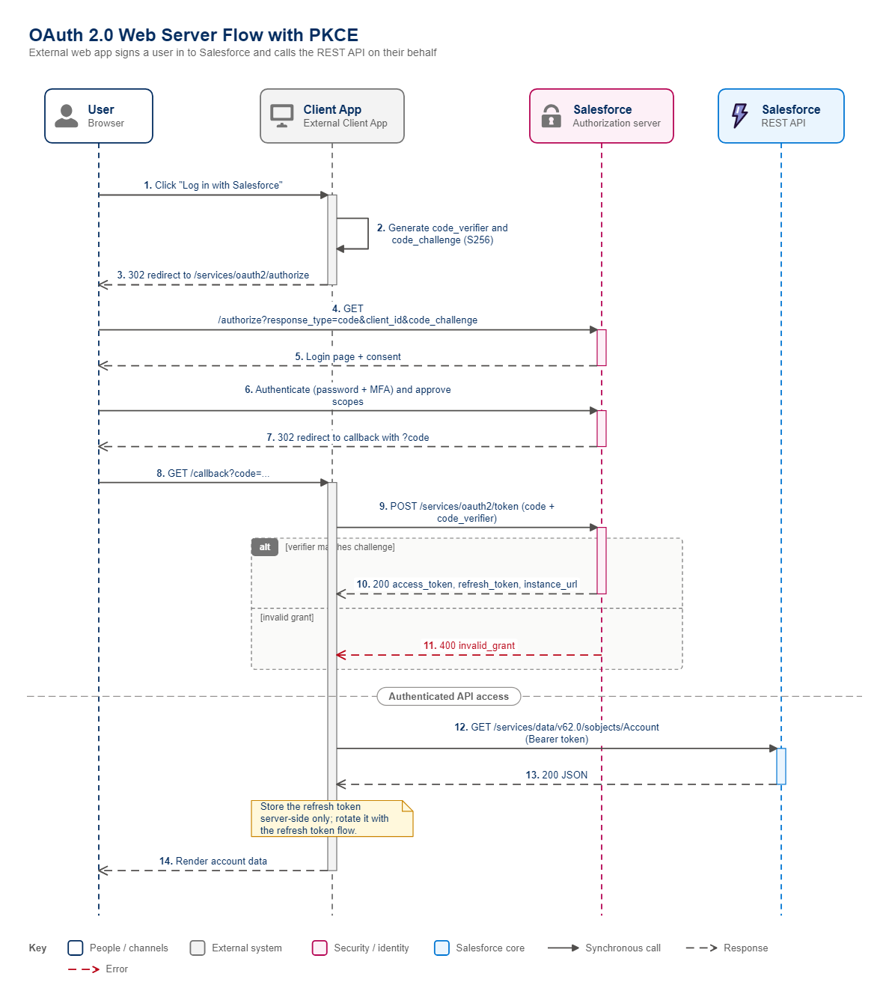</a>
<br><b><code>oauth-flow</code></b><br>
How does this OAuth / SSO flow authenticate and authorise step by step?<br>
<sub><b>Ask:</b> "Diagram the OAuth 2.0 web server flow with PKCE for our external client app."</sub><br>
<sub><a href="examples/oauth-flow.json">spec</a> · <a href="examples/oauth-flow.drawio">draw.io</a> · <a href="examples/oauth-flow.html">HTML</a></sub>
</td>
<td width="50%" valign="top">
<a href="examples/data-model.html">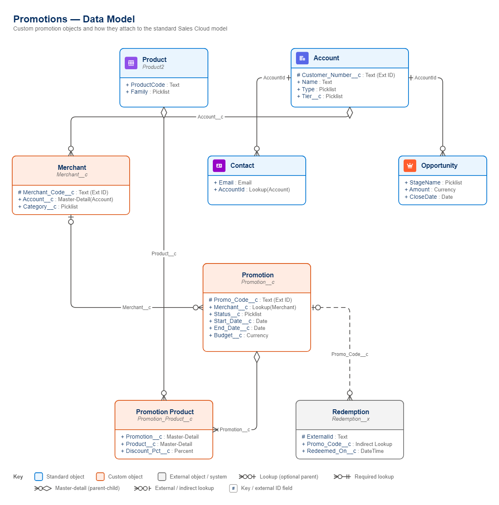</a>
<br><b><code>data-model</code></b><br>
Which objects and fields exist and how are they related? (Salesforce ERD notation)<br>
<sub><b>Ask:</b> "Generate an ERD from ./force-app for Promotion__c, Merchant__c and everything they relate to."</sub><br>
<sub><a href="examples/data-model.json">spec</a> · <a href="examples/data-model.drawio">draw.io</a> · <a href="examples/data-model.html">HTML</a></sub>
</td>
</tr>
<tr>
<td width="50%" valign="top">
<a href="examples/data-flow.html">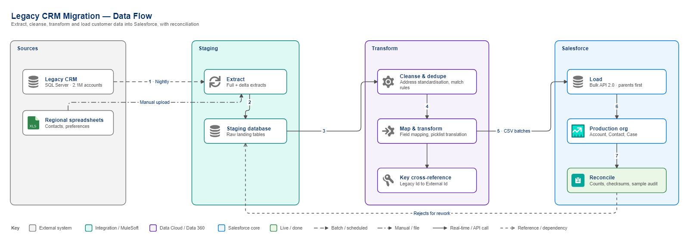</a>
<br><b><code>data-flow</code></b><br>
Where does data originate, how is it transformed and where does it land?<br>
<sub><b>Ask:</b> "Show the data migration flow from the legacy CRM through staging and transformation into Salesforce."</sub><br>
<sub><a href="examples/data-flow.json">spec</a> · <a href="examples/data-flow.drawio">draw.io</a> · <a href="examples/data-flow.html">HTML</a></sub>
</td>
<td width="50%" valign="top">
<a href="examples/data-cloud-architecture.html">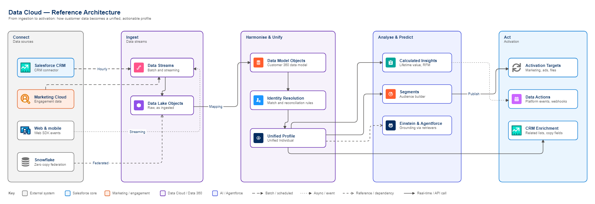</a>
<br><b><code>data-cloud-architecture</code></b><br>
How does data move through Data Cloud: ingest, harmonise, unify, analyse and activate?<br>
<sub><b>Ask:</b> "Draw the Data Cloud architecture from ingestion to activation."</sub><br>
<sub><a href="examples/data-cloud-architecture.json">spec</a> · <a href="examples/data-cloud-architecture.drawio">draw.io</a> · <a href="examples/data-cloud-architecture.html">HTML</a></sub>
</td>
</tr>
<tr>
<td width="50%" valign="top">
<a href="examples/data-cloud-mapping.html">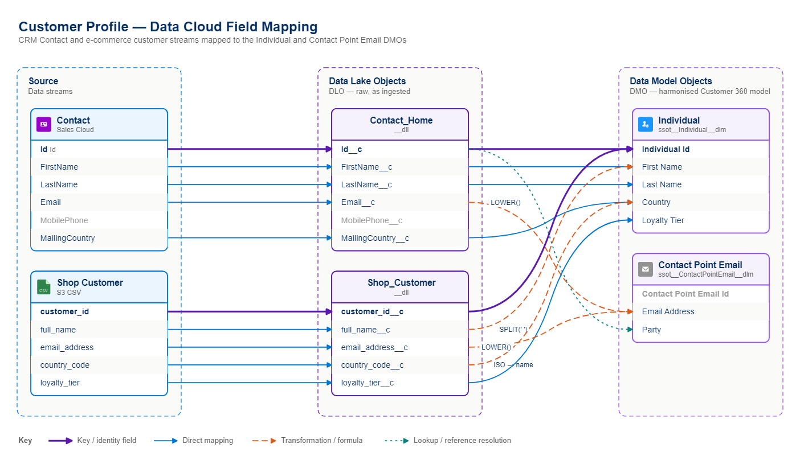</a>
<br><b><code>data-cloud-mapping</code></b><br>
Which source fields map to which DLO and DMO fields, with what transformation?<br>
<sub><b>Ask:</b> "Here is mappings.csv: build the Data Cloud field mapping diagram, DLO to DMO."</sub><br>
<sub><a href="examples/data-cloud-mapping.json">spec</a> · <a href="examples/data-cloud-mapping.drawio">draw.io</a> · <a href="examples/data-cloud-mapping.html">HTML</a></sub>
</td>
<td width="50%" valign="top">
<a href="examples/sharing-model.html">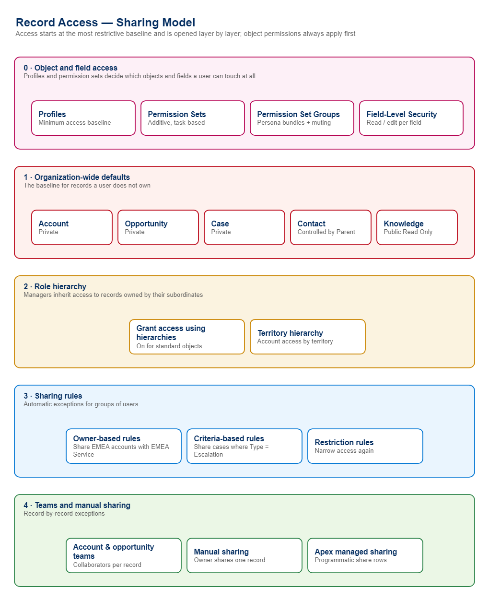</a>
<br><b><code>sharing-model</code></b><br>
How is record access opened up, layer by layer, from org-wide defaults to manual sharing?<br>
<sub><b>Ask:</b> "Explain our record access design as a layered sharing model, from OWD to manual sharing."</sub><br>
<sub><a href="examples/sharing-model.json">spec</a> · <a href="examples/sharing-model.drawio">draw.io</a> · <a href="examples/sharing-model.html">HTML</a></sub>
</td>
</tr>
<tr>
<td width="50%" valign="top">
<a href="examples/role-hierarchy.html">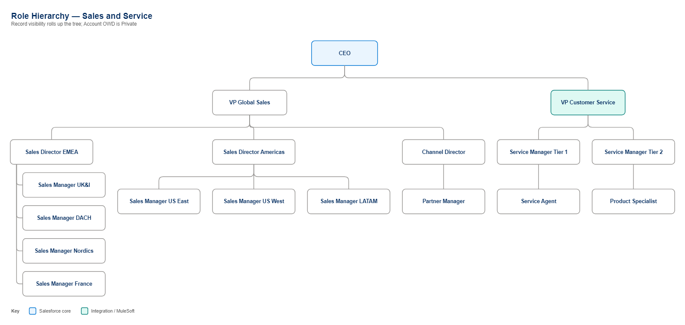</a>
<br><b><code>role-hierarchy</code></b><br>
How does the role hierarchy roll record visibility upward?<br>
<sub><b>Ask:</b> "Draw the role hierarchy for sales and service."</sub><br>
<sub><a href="examples/role-hierarchy.json">spec</a> · <a href="examples/role-hierarchy.drawio">draw.io</a> · <a href="examples/role-hierarchy.html">HTML</a></sub>
</td>
<td width="50%" valign="top">
<a href="examples/permission-matrix.html">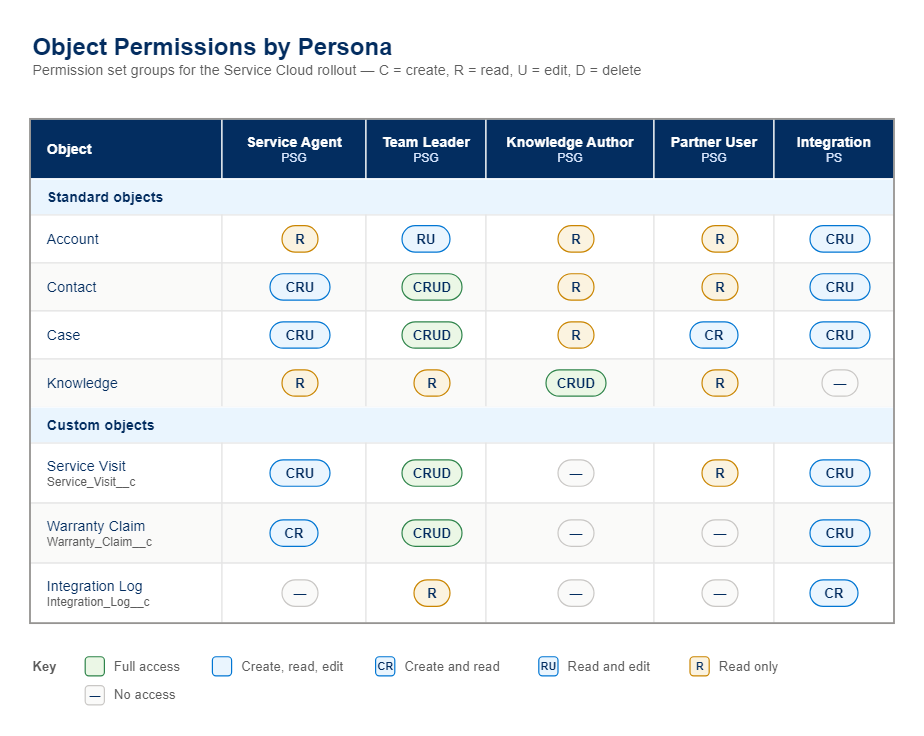</a>
<br><b><code>permission-matrix</code></b><br>
Which profile or permission set gets which access to which object?<br>
<sub><b>Ask:</b> "Create an object permission matrix by persona for the permission set groups."</sub><br>
<sub><a href="examples/permission-matrix.json">spec</a> · <a href="examples/permission-matrix.drawio">draw.io</a> · <a href="examples/permission-matrix.html">HTML</a></sub>
</td>
</tr>
</table>

### Design

Behaviour and experience: how records move, how logic branches, what users see.

<table>
<tr>
<td width="50%" valign="top">
<a href="examples/state-lifecycle.html">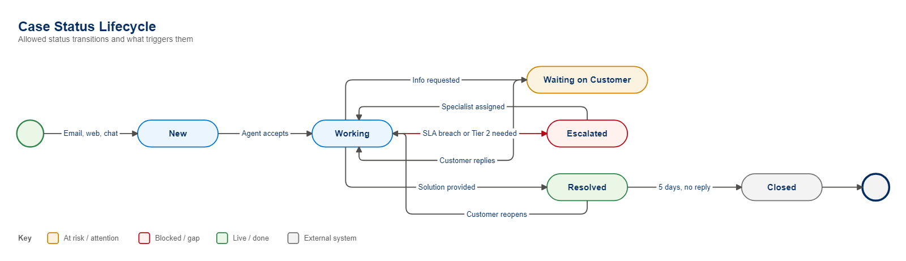</a>
<br><b><code>state-lifecycle</code></b><br>
Which statuses can a record move through, and what triggers each transition?<br>
<sub><b>Ask:</b> "Diagram the Case status lifecycle with what triggers each transition."</sub><br>
<sub><a href="examples/state-lifecycle.json">spec</a> · <a href="examples/state-lifecycle.drawio">draw.io</a> · <a href="examples/state-lifecycle.html">HTML</a></sub>
</td>
<td width="50%" valign="top">
<a href="examples/flowchart.html">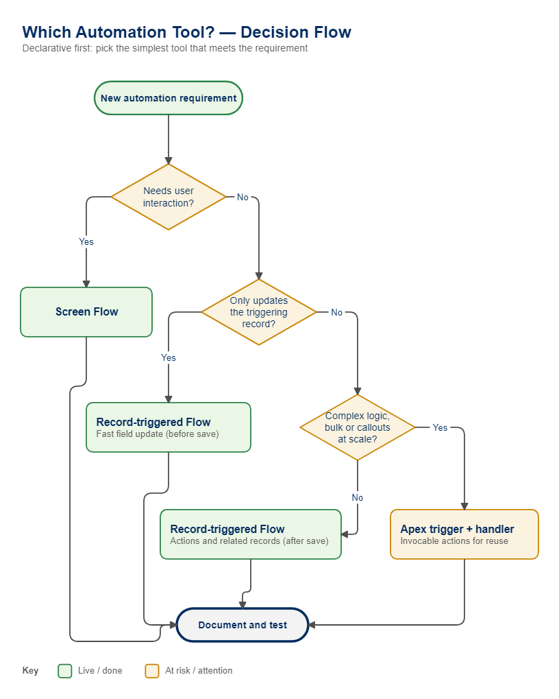</a>
<br><b><code>flowchart</code></b><br>
What is the logic, decision by decision?<br>
<sub><b>Ask:</b> "Make a decision flow for choosing between Screen Flow, record-triggered Flow and Apex."</sub><br>
<sub><a href="examples/flowchart.json">spec</a> · <a href="examples/flowchart.drawio">draw.io</a> · <a href="examples/flowchart.html">HTML</a></sub>
</td>
</tr>
<tr>
<td width="50%" valign="top">
<a href="examples/lightning-page-wireframe.html">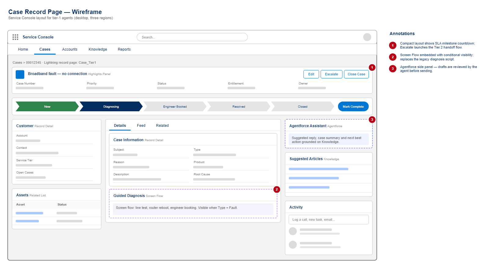</a>
<br><b><code>lightning-page-wireframe</code></b><br>
What goes where on this Lightning page or screen?<br>
<sub><b>Ask:</b> "Wireframe the Case record page for the Service Console with annotations."</sub><br>
<sub><a href="examples/lightning-page-wireframe.json">spec</a> · <a href="examples/lightning-page-wireframe.drawio">draw.io</a> · <a href="examples/lightning-page-wireframe.html">HTML</a></sub>
</td>
<td width="50%" valign="top">
<a href="examples/class-diagram.html">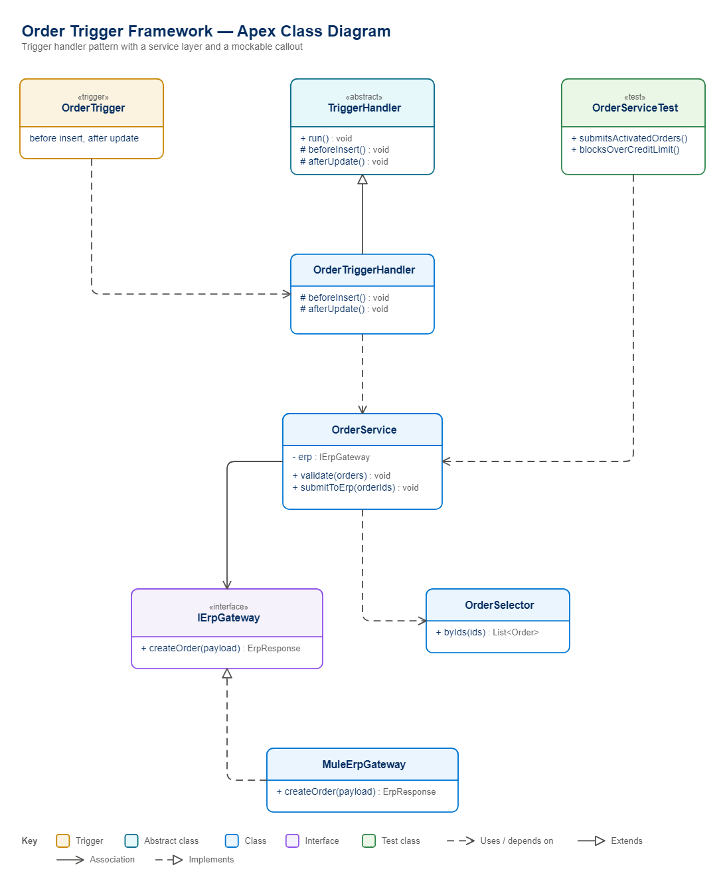</a>
<br><b><code>class-diagram</code></b><br>
Which Apex classes and interfaces exist and how do they depend on each other?<br>
<sub><b>Ask:</b> "Draw a class diagram of our Apex trigger framework and service layer."</sub><br>
<sub><a href="examples/class-diagram.json">spec</a> · <a href="examples/class-diagram.drawio">draw.io</a> · <a href="examples/class-diagram.html">HTML</a></sub>
</td>
</tr>
</table>

### Agentforce

AI agent design: orchestration on one page, each topic's logic on the next.

<table>
<tr>
<td width="50%" valign="top">
<a href="examples/agent-interaction-map.html">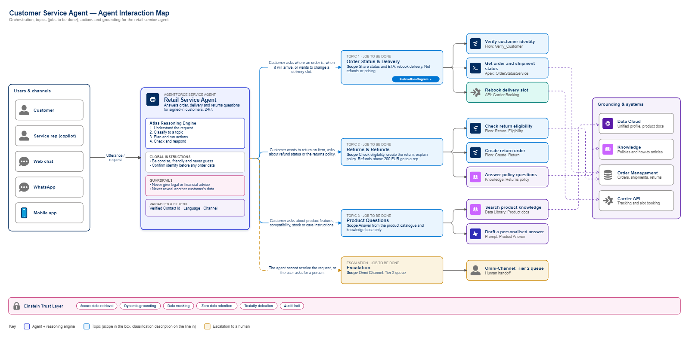</a>
<br><b><code>agent-interaction-map</code></b><br>
How is an AI agent orchestrated: channels, reasoning, topics (jobs to be done), actions and grounding?<br>
<sub><b>Ask:</b> "Design an Agent Interaction Map for our service agent: channels, topics, actions and grounding."</sub><br>
<sub><a href="examples/agent-interaction-map.json">spec</a> · <a href="examples/agent-interaction-map.drawio">draw.io</a> · <a href="examples/agent-interaction-map.html">HTML</a></sub>
</td>
<td width="50%" valign="top">
<a href="examples/agent-instruction-diagram.html">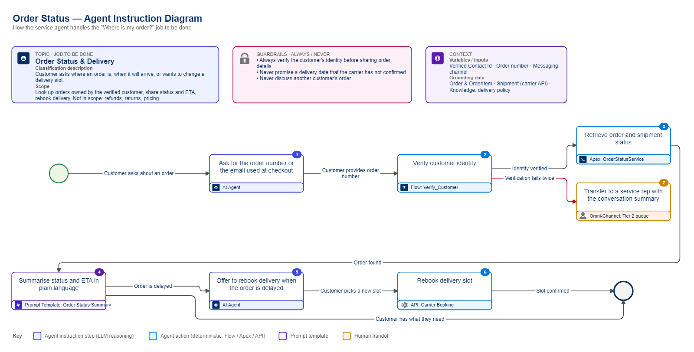</a>
<br><b><code>agent-instruction-diagram</code></b><br>
Inside one topic: which instruction steps, actions, prompts and guardrails does the agent follow?<br>
<sub><b>Ask:</b> "Draw the Agent Instruction Diagram for the Order Status topic with guardrails."</sub><br>
<sub><a href="examples/agent-instruction-diagram.json">spec</a> · <a href="examples/agent-instruction-diagram.drawio">draw.io</a> · <a href="examples/agent-instruction-diagram.html">HTML</a></sub>
</td>
</tr>
</table>

### Build

Environments, pipelines and automation as built.

<table>
<tr>
<td width="50%" valign="top">
<a href="examples/environment-strategy.html">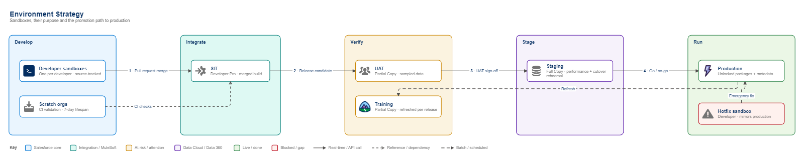</a>
<br><b><code>environment-strategy</code></b><br>
Which orgs and sandboxes exist and how do changes move between them?<br>
<sub><b>Ask:</b> "Diagram our sandbox and environment strategy with the promotion path to production."</sub><br>
<sub><a href="examples/environment-strategy.json">spec</a> · <a href="examples/environment-strategy.drawio">draw.io</a> · <a href="examples/environment-strategy.html">HTML</a></sub>
</td>
<td width="50%" valign="top">
<a href="examples/devops-pipeline.html">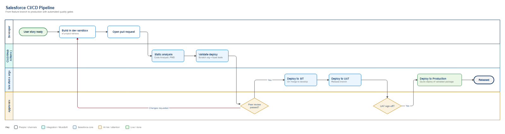</a>
<br><b><code>devops-pipeline</code></b><br>
What happens from commit to production, with which gates and checks?<br>
<sub><b>Ask:</b> "Show the CI/CD pipeline from pull request to production with quality gates."</sub><br>
<sub><a href="examples/devops-pipeline.json">spec</a> · <a href="examples/devops-pipeline.drawio">draw.io</a> · <a href="examples/devops-pipeline.html">HTML</a></sub>
</td>
</tr>
<tr>
<td width="50%" valign="top">
<a href="examples/branching-strategy.html">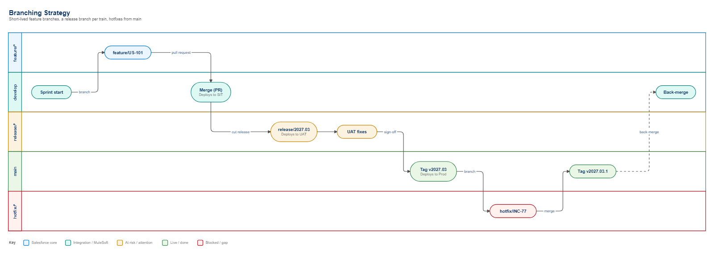</a>
<br><b><code>branching-strategy</code></b><br>
Which branches exist and how do changes merge between them?<br>
<sub><b>Ask:</b> "Illustrate our git branching strategy: feature, develop, release, main, hotfix."</sub><br>
<sub><a href="examples/branching-strategy.json">spec</a> · <a href="examples/branching-strategy.drawio">draw.io</a> · <a href="examples/branching-strategy.html">HTML</a></sub>
</td>
<td width="50%" valign="top">
<a href="examples/flow-logic.html">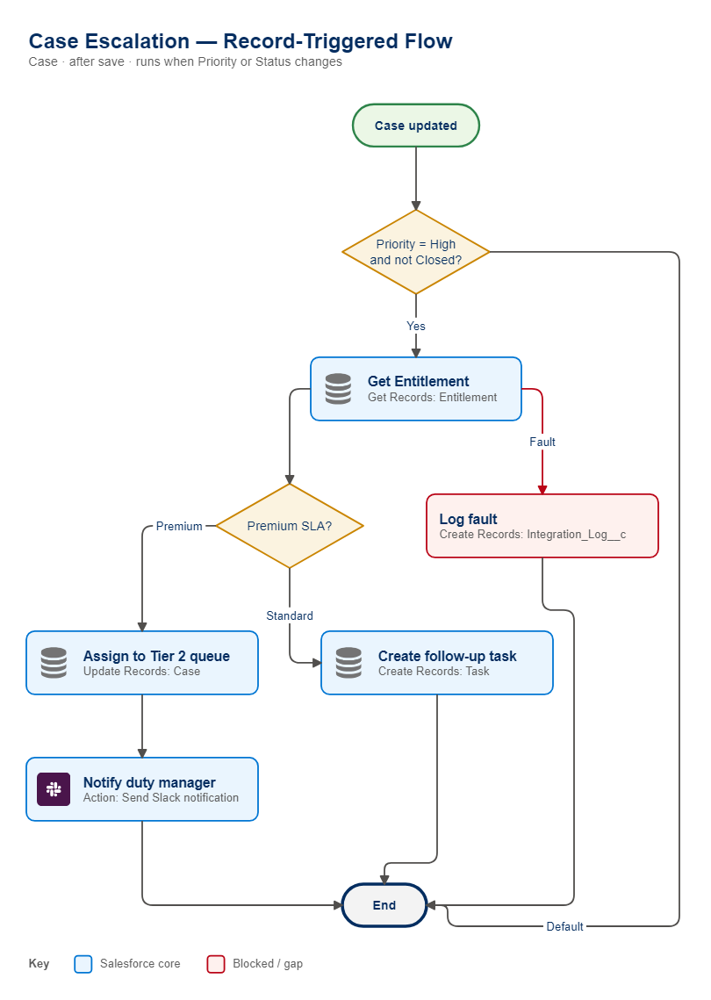</a>
<br><b><code>flow-logic</code></b><br>
What does this Salesforce Flow or Apex trigger do, element by element?<br>
<sub><b>Ask:</b> "Turn Case_Escalation.flow-meta.xml into a flow logic diagram."</sub><br>
<sub><a href="examples/flow-logic.json">spec</a> · <a href="examples/flow-logic.drawio">draw.io</a> · <a href="examples/flow-logic.html">HTML</a></sub>
</td>
</tr>
</table>

### Test

What is tested, by whom, and whether every requirement is covered.

<table>
<tr>
<td width="50%" valign="top">
<a href="examples/test-strategy.html">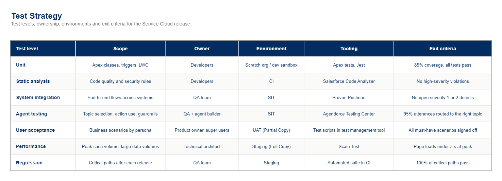</a>
<br><b><code>test-strategy</code></b><br>
Which test levels run where, by whom, with what tools and exit criteria?<br>
<sub><b>Ask:</b> "Summarise the test strategy: levels, owners, environments, tools and exit criteria."</sub><br>
<sub><a href="examples/test-strategy.json">spec</a> · <a href="examples/test-strategy.drawio">draw.io</a> · <a href="examples/test-strategy.html">HTML</a></sub>
</td>
<td width="50%" valign="top">
<a href="examples/traceability-matrix.html">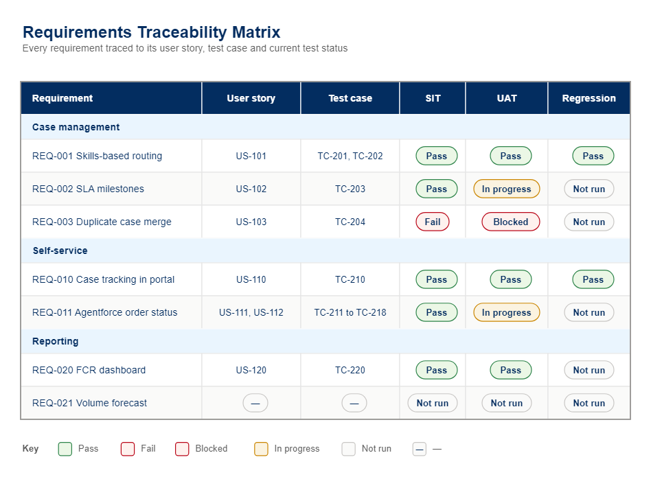</a>
<br><b><code>traceability-matrix</code></b><br>
Is every requirement covered by a test, and what is its status?<br>
<sub><b>Ask:</b> "Build a requirements traceability matrix with SIT and UAT status."</sub><br>
<sub><a href="examples/traceability-matrix.json">spec</a> · <a href="examples/traceability-matrix.drawio">draw.io</a> · <a href="examples/traceability-matrix.html">HTML</a></sub>
</td>
</tr>
<tr>
<td width="50%" valign="top">
<a href="examples/defect-lifecycle.html">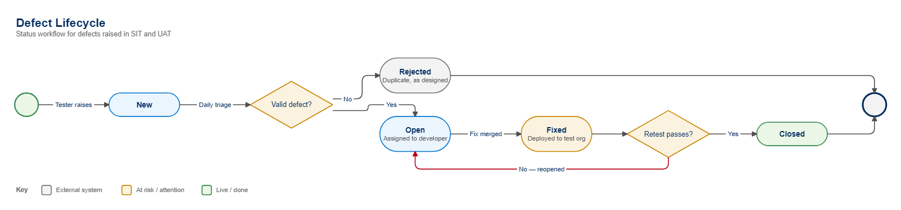</a>
<br><b><code>defect-lifecycle</code></b><br>
How does a defect move from raised to closed?<br>
<sub><b>Ask:</b> "Draw the defect lifecycle used in SIT and UAT."</sub><br>
<sub><a href="examples/defect-lifecycle.json">spec</a> · <a href="examples/defect-lifecycle.drawio">draw.io</a> · <a href="examples/defect-lifecycle.html">HTML</a></sub>
</td>
<td width="50%"></td>
</tr>
</table>

### Release

Plans, cutover and risk.

<table>
<tr>
<td width="50%" valign="top">
<a href="examples/roadmap.html">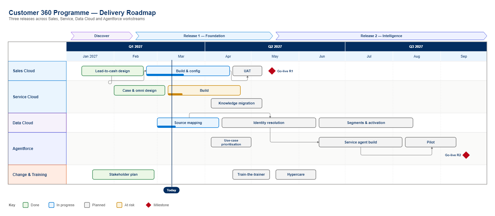</a>
<br><b><code>roadmap</code></b><br>
What is delivered when, across workstreams and releases?<br>
<sub><b>Ask:</b> "Create a three-release roadmap across Sales, Service, Data Cloud and Agentforce."</sub><br>
<sub><a href="examples/roadmap.json">spec</a> · <a href="examples/roadmap.drawio">draw.io</a> · <a href="examples/roadmap.html">HTML</a></sub>
</td>
<td width="50%" valign="top">
<a href="examples/project-plan.html">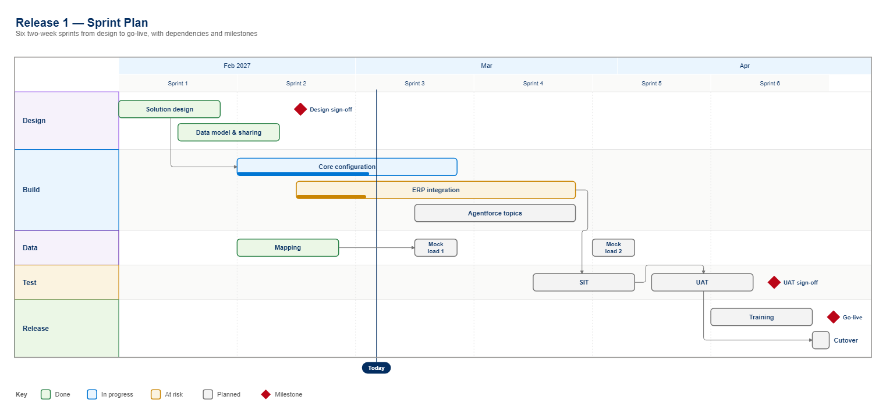</a>
<br><b><code>project-plan</code></b><br>
What are the tasks, durations, dependencies and milestones? (gantt)<br>
<sub><b>Ask:</b> "Make a sprint-level gantt for Release 1 with dependencies and milestones."</sub><br>
<sub><a href="examples/project-plan.json">spec</a> · <a href="examples/project-plan.drawio">draw.io</a> · <a href="examples/project-plan.html">HTML</a></sub>
</td>
</tr>
<tr>
<td width="50%" valign="top">
<a href="examples/cutover-plan.html">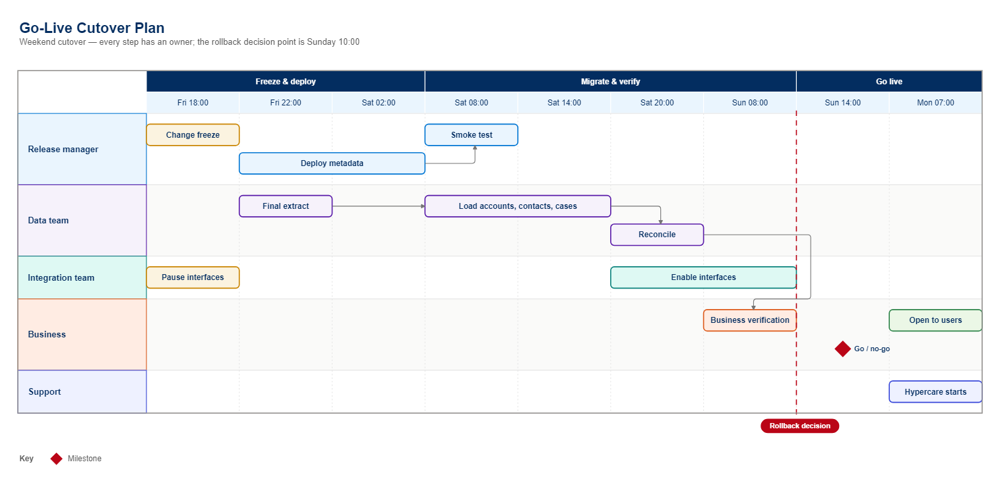</a>
<br><b><code>cutover-plan</code></b><br>
What happens hour by hour during go-live, and who owns each step?<br>
<sub><b>Ask:</b> "Draw the go-live weekend cutover plan with owners and the rollback decision point."</sub><br>
<sub><a href="examples/cutover-plan.json">spec</a> · <a href="examples/cutover-plan.drawio">draw.io</a> · <a href="examples/cutover-plan.html">HTML</a></sub>
</td>
<td width="50%" valign="top">
<a href="examples/risk-matrix.html">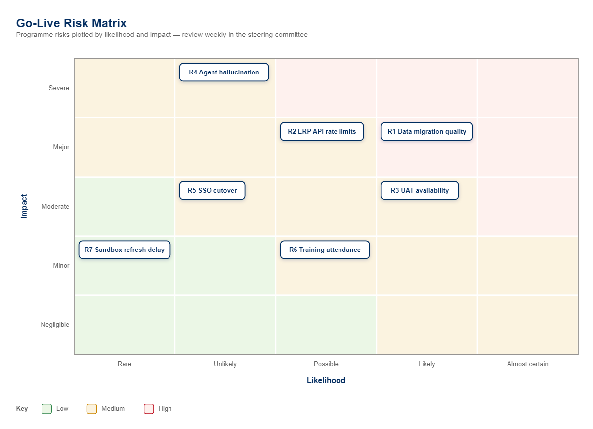</a>
<br><b><code>risk-matrix</code></b><br>
Which risks are most likely and most damaging?<br>
<sub><b>Ask:</b> "Plot the programme risks on a 5 by 5 likelihood / impact matrix."</sub><br>
<sub><a href="examples/risk-matrix.json">spec</a> · <a href="examples/risk-matrix.drawio">draw.io</a> · <a href="examples/risk-matrix.html">HTML</a></sub>
</td>
</tr>
</table>

<!-- gallery:end -->

Start any of them from a complete example: `archistry init <type>`.

## ✏️ Edit in draw.io or in the browser

Both files come from the same model, and each converts to the other without loss.

| | `diagram.drawio` | `diagram.html` |
|---|---|---|
| **Open with** | draw.io desktop, app.diagrams.net, VS Code extension | Any browser, offline, one file |
| **Best for** | Detailed editing, team libraries, version control | Sharing, presenting, quick edits |
| **You can** | Everything draw.io can do | Move, resize, retext, recolour, add, connect, undo |
| **Export** | Everything draw.io exports | PNG, JPG, SVG, .drawio, print to PDF |

<details open>
<summary><b>HTML page: keyboard and mouse</b></summary>
<br>

| Explore mode | | Edit mode (<kbd>E</kbd>) | |
|---|---|---|---|
| Pan | drag | Move a box | drag (10px grid) |
| Zoom / fit | <kbd>Ctrl</kbd> + wheel / <kbd>0</kbd> | Resize | corner handles |
| Highlight connections | click a box | Change text | double-click |
| Find a box | <kbd>/</kbd> | Recolour | palette swatches |
| Animate connectors | <kbd>L</kbd> | Add cards, notes, zones, icons | toolbar |
| Light / dark | <kbd>T</kbd> | Connect two boxes | toolbar |
| Present full screen | <kbd>P</kbd> | Undo / redo | <kbd>Ctrl</kbd> + <kbd>Z</kbd> / <kbd>Y</kbd> |

On an Agent Interaction Map, click a topic to drill down to its instruction diagram. When you are
done, use **Export** to save PNG, JPG or SVG, **Save HTML** (with your edits) or **Download .drawio**.

</details>

The draw.io files are uncompressed XML, so they diff cleanly in git. Connectors stay attached when
you drag boxes in draw.io. To move between formats after editing:

```bash
archistry convert diagram.html   -o diagram.drawio   # after editing in the browser
archistry convert diagram.drawio -o diagram.html     # after editing in draw.io
```


> `convert` works on any `.drawio` file. Shapes from other stencil libraries (AWS, mockups) show as
> plain boxes in the HTML viewer but are kept untouched in the `.drawio`.

## 📷 Images for your documents

| I want | Command |
|---|---|
| A PNG for Word or Confluence | `archistry export diagram.drawio -o diagram.png` |
| A JPG of my browser edits | `archistry export diagram.html -o diagram.jpg` |
| PNG, JPG and SVG at once | `archistry export diagram.drawio --format png,jpg,svg` |
| A dark-theme image | `archistry export diagram.drawio -o dark.png --theme dark` |
| One page of a multi-page file | `archistry export diagram.drawio -o p2.png --page 2` |
| A transparent background | `archistry export diagram.drawio -o clear.png --transparent` |
| Print resolution | `archistry export diagram.drawio -o big.png --scale 4` |

SVG needs only Node. PNG and JPG use your local Chrome, Edge, Chromium or Brave in headless mode
(set `ARCHISTRY_BROWSER` to pick one). No Node? Use the **Export** menu in the HTML page.


> **PowerPoint:** insert the SVG, then choose *Convert to Shape* to get native, editable shapes.

## 🧩 Start from real metadata

| You have | Run | You get |
|---|---|---|
| 📦 An SFDX project | `archistry erd-from-sfdx ./ -o erd.json --objects Account,Case` | A `data-model` with objects, key fields and lookup / master-detail relationships |
| 📊 A mapping CSV | `archistry mapping-from-csv mappings.csv -o mapping.json` | A `data-cloud-mapping` with sources, DMOs and every field mapping |
| 🔀 A Flow | `archistry flow-from-metadata My_Flow.flow-meta.xml -o flow.json` | A `flow-logic` diagram with decisions, record operations, loops and fault paths |

Each writes a spec you can trim and retitle before `archistry build`.

## ⚙️ How it works

<p align="center">
  <a href="docs/how-it-works.html">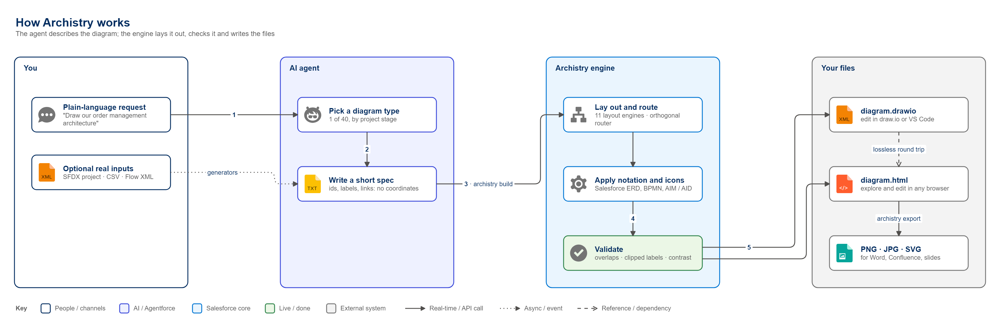</a>
  <br><sub>Drawn by Archistry itself from <a href="docs/how-it-works.json">this spec</a>. Click to open the interactive version.</sub>
</p>

<details>
<summary><b>What a spec looks like</b></summary>
<br>

A spec is small and readable. No coordinates and no styles: colour comes from `kind`, and the key
is generated from the kinds you used.

```json
{
  "type": "solution-architecture",
  "title": "Order Management — Solution Architecture",
  "children": [
    { "zone": "Channels", "kind": "user", "children": [
      { "id": "store", "label": "B2C Storefront", "icon": "platform/web" } ] },
    { "zone": "Salesforce Platform", "kind": "salesforce", "children": [
      { "id": "commerce", "label": "Commerce Cloud", "icon": "product/commerce_cloud" },
      { "id": "agent", "label": "Agentforce", "icon": "standard/agent_astro", "kind": "ai" } ] },
    { "zone": "Enterprise", "kind": "external", "children": [
      { "id": "sap", "label": "SAP S/4HANA", "icon": "utility/database" } ] }
  ],
  "links": [
    { "from": "store", "to": "commerce", "label": "HTTPS", "step": 1 },
    { "from": "commerce", "to": "sap", "label": "Orders", "style": "async", "step": 2 }
  ]
}
```

Every field for every layout engine is documented in [`references/`](references/).
[`SKILL.md`](SKILL.md) is the agent's workflow.

</details>

## 📖 Commands

Your agent runs these for you. To use them yourself, add a shortcut:

```bash
alias archistry="node ~/.claude/skills/archistry/scripts/archistry.mjs"
```

| Command | What it does |
|---|---|
| `archistry types` | List all 40 diagram types (`--stage architect` to filter) |
| `archistry init <type>` | Write a complete starter spec for a type |
| `archistry build <spec.json>` | Build the diagram (`--format drawio,html,png,jpg,svg` or `all`) |
| `archistry validate <file>` | Check a `.drawio`, `.html` or spec for layout and notation problems |
| `archistry convert <in> -o <out>` | Convert `.drawio` ⇄ `.html` |
| `archistry export <in> -o <out>` | Save as PNG, JPG or SVG ([options](#-images-for-your-documents)) |
| `archistry icons search <text>` | Find a Salesforce icon key |
| `archistry erd-from-sfdx` · `mapping-from-csv` · `flow-from-metadata` | Generate a spec from real metadata ([details](#-start-from-real-metadata)) |
| `archistry doctor` | Check Node, the browser and the setup |

Run `archistry help` for every option.

## 💡 Good to know

<details>
<summary><b>Can I use my company's colours and font?</b></summary>
<br>

Yes. Put a `brand.json` beside your spec (schema and example in
[`assets/brand/brand.example.json`](assets/brand/brand.example.json)). Palette and font follow your
brand; notation (crow's feet, BPMN shapes, line styles) stays standard.

</details>

<details>
<summary><b>Does my data leave my machine?</b></summary>
<br>

No. The build runs in Node on your machine. Image export runs in your own browser, headless, on a
local temporary file. The HTML output makes no network requests. If your architecture, data model
or agent design should not pass through a hosted diagramming tool, this workflow is built for that.

</details>

<details>
<summary><b>What's in this folder?</b> (for contributors)</summary>
<br>

```
SKILL.md              the agent's workflow, type catalogue and rules
references/           one reference per layout engine, plus output formats and raw draw.io rules
scripts/archistry.mjs the command line
scripts/lib/          layout engines, router, renderer, validator, HTML packager, image export
assets/icons/         embedded Salesforce icon catalogue
assets/viewer/        the HTML viewer and editor
assets/brand/         brand override schema and example
examples/             a spec, a .drawio and an .html for every diagram type
docs/                 README pictures, the how-it-works diagram and the logo
```

- `node scripts/build-examples.mjs` rebuilds every example, preview and the gallery above, and
  fails if any example stops validating.
- `node scripts/build-banner.mjs` rebuilds the banner.

</details>

## ⭐ If Archistry helped

Archistry is free and open source. If it saved you an hour on a diagram, a star is the best thank-you, and it helps other Salesforce teams find it.

<p align="center">
  <a href="https://github.com/abhishakec/archistry/stargazers"></a>
</p>

## 🙏 Credits

Archistry is an original, independent project. Its engine, layouts, viewer, notation renditions and
documentation were written from scratch. The projects and publications below were studied as
inspiration and reference; no code, diagrams or design assets were copied from them. With thanks to:

### Inspiration and references

- **[Elements.cloud](https://elements.cloud/)**: their published **Agent Interaction Map (AIM)** and
  **Agent Instruction Diagram (AID)** method informed this skill's two Agentforce diagram types:
  topics as jobs to be done, classification on the line and scope in the box, drill-down from a topic
  to its instructions, and the distinction between instruction steps, actions, prompt templates and
  guardrails. See their [Agent Designer](https://elements.cloud/agent-designer/) and guides on
  [creating an Agent Interaction Map](https://support.elements.cloud/en/articles/11666898-how-to-create-agent-interaction-map)
  and
  [designing agent instructions](https://support.elements.cloud/en/articles/11406803-how-to-design-good-agent-instructions-with-agent-instruction-diagram).
  Archistry's versions are its own interpretation, unofficial and not endorsed by Elements; for the
  original governed experience, use Elements.
- **[Salesforce Diagramming Framework](https://architect.salesforce.com/diagrams)**: the public
  guidance and data-model notation that the architecture and ERD conventions follow.
- **[Archify](https://github.com/tt-a1i/archify) by [@tt-a1i](https://github.com/tt-a1i)**: an
  inspiring example of agents writing a semantic description and leaving layout, validation and an
  explorable HTML page to a deterministic tool.
- **[sf-skills](https://github.com/forcedotcom/sf-skills) by Salesforce**: a useful reference for
  which Salesforce diagram scenarios matter most to practitioners.
- **[Diagramforce](https://diagramforce.mateuszdabrowski.pl/) by
  [Mateusz Dąbrowski](https://github.com/mateuszdabrowski)**: helpful thinking on
  Salesforce-specific diagram types.
- **[draw.io](https://www.drawio.com/) by JGraph** and the
  **[draw.io Integration](https://github.com/hediet/vscode-drawio) for VS Code by
  [@hediet](https://github.com/hediet)**: the open file format Archistry writes, and the editors it
  is designed to work with.

### Third-party artwork included, with attribution

Icons are not original to this project and remain their owners' work:

- **Salesforce product, platform, industry and document-type icons** from the community
  [drawIo-Salesforce](https://github.com/ehsky/drawIo-Salesforce) library by
  [@ehsky](https://github.com/ehsky), included so diagrams render without installing a shape library.
- **SLDS icons** © Salesforce, licensed [CC BY-ND 4.0](https://creativecommons.org/licenses/by-nd/4.0/).
- **[Sora](https://github.com/sora-xor/sora-font)**, **[Inter](https://rsms.me/inter/)** and
  **[JetBrains Mono](https://www.jetbrains.com/lp/mono/)** fonts (SIL Open Font License 1.1), used for
  the wordmark and banner.

Full details and licence texts: [THIRD-PARTY-NOTICES.md](THIRD-PARTY-NOTICES.md).


> Salesforce, Agentforce, Data Cloud, MuleSoft, Tableau and Slack are trademarks of Salesforce, Inc.
> Elements.cloud is a trademark of its owner. "Archistry" is the name of this community project and
> implies no relationship with any of them. This is an unofficial community project, not affiliated
> with, endorsed by or supported by Salesforce or Elements.cloud.

## 📄 License

- **Code and documentation:** [MIT](LICENSE). Use, modify and redistribute freely, commercially
  too; keep the copyright notice.
- **Bundled icons and fonts:** keep their own terms, listed in
  [THIRD-PARTY-NOTICES.md](THIRD-PARTY-NOTICES.md).
- **Diagrams you create** with Archistry are yours.
